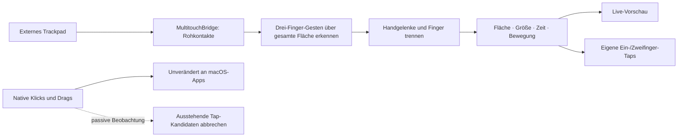

# PalmGuard

Native macOS-App für ein externes Apple Magic Trackpad unter einer Tastatur: eine frei
einstellbare Tap-Fläche, Live-Kontakte und Schutz gegen versehentliche Taps durch
aufliegende Handgelenke.

**Status: experimentelle Version.** Rohkontakte verwenden private
macOS-Schnittstellen. Die App zeigt ihre tatsächliche Wirkung über Diagnosezähler an;
eine perfekte Unterscheidung zwischen Absicht und Handballen ist nicht möglich.

## Starten

Voraussetzungen: macOS 14 oder neuer, Xcode mit Swift 6, externes Apple Magic Trackpad.
Keine Paketabhängigkeiten, kein Server, keine Telemetrie.

```sh
swift test
bash scripts/build-app.sh
open dist/PalmGuard.app
```

Für einen festen Installationsort die erstellte App nach `~/Applications` ziehen. macOS
verlangt die Freigabe für **Datenschutz & Sicherheit → Bedienungshilfen**. Wenn der
Ereigniszugriff weiter fehlt, zusätzlich **Eingabeüberwachung** prüfen und App neu starten.
Die App bietet direkte Schaltflächen zu diesen Einstellungen.

Lokale Builds werden ad hoc signiert. Für eine stabile eigene Signatur:

```sh
PALMGUARD_SIGNING_IDENTITY='Developer ID Application: …' bash scripts/build-app.sh
```

Ohne Developer-ID-Zertifikat ist der Build nicht notarisiert. Nach einem Neubau kann macOS
eine erneute Berechtigungsfreigabe verlangen. Die App läuft außerhalb der App Sandbox.

### Freigabe an, aber Schutz startet nicht

Ein lokaler Neubau kann eine andere Ad-hoc-Signatur erhalten. macOS zeigt den alten
Bedienungshilfen-Schalter dann weiterhin als eingeschaltet an, erlaubt der neuen App aber
keinen Zugriff. Beim Aktivieren zeigt PalmGuard dazu einen Fehlerdialog mit dem tatsächlichen
Installationspfad. Über „App im Finder zeigen“ findest du genau diese App.

Nach dem letzten Neubau PalmGuard beenden, den alten PalmGuard-Eintrag in Bedienungshilfen
mit **−** entfernen und die aktuelle App mit **+** erneut hinzufügen. Danach die App neu starten
und den Schutz aktivieren. Andere Apps und Berechtigungen müssen nicht zurückgesetzt werden.

## Einrichten

1. App öffnen, Trackpad vollständig loslassen und die Live-Kontakte prüfen.
2. Im Trackpad-Bild die erlaubte Fläche als Rechteck ziehen. Alternativ die vier Randregler
   verwenden. Oben entspricht der Tastaturseite, unten der dir zugewandten Seite.
3. Handgelenke auflegen. Orange markiert Kontakte außerhalb der Fläche oder über der
   eingestellten Kontaktgröße. Grün markiert geometrisch zulässige Kontakte.
4. **Natives „Tippen zum Klicken“ in den macOS-Trackpad-Einstellungen ausschalten.**
   PalmGuard liest die Einstellung aus dem aktiven Treiber des ausgewählten Trackpads.
   Nur falls das nicht möglich ist, muss die ausgeschaltete Einstellung manuell bestätigt werden.
5. **Schutz aktivieren**. Beim Start bleibt die App zunächst in Vorschau. Unter „Erzeugte
   Tap-Klicks“ siehst du die tatsächlich von PalmGuard erzeugten Klicks.

### Nur Taps innerhalb der Fläche

PalmGuard erzeugt eigene Ein- und Zweifinger-Taps. Andere Tools dürfen für dieses Trackpad
keine zusätzlichen Tap-Klicks erzeugen. Native Mausereignisse werden ausschließlich mit
`listenOnly` beobachtet: PalmGuard kann Druck-Klicks oder Drags weder blockieren noch verändern.

PalmGuard erzeugt bei kurzen, stationären Kontakten in der erlaubten Fläche:

| Geste | Ergebnis |
| --- | --- |
| Ein Finger | Linksklick |
| Zwei nahezu gleichzeitig aufgesetzte Finger | Rechtsklick |
| Lange oder wandernde Kontakte | Kein erzeugter Klick |
| Drei Finger, auch mit Fingern außerhalb der Fläche | Native Geste; kein erzeugter Tap-Klick |
| Druck-/Force-Klick, auch außerhalb der Fläche | Unverändert durch macOS |
| Drei-Finger-Drag, auch mit einem Finger außerhalb | Unverändert durch macOS |
| Große oder außerhalb gestartete Kontakte | Bis zum Abheben ignoriert |
| Handgelenk außerhalb plus neuer Finger innerhalb | Finger separat auswerten |

Die Kontaktgröße ist ein relativer Sensorwert, kein verlässlicher Druck- oder Flächenwert.
Schwellwerte lassen sich unter „Empfindlichkeit & Diagnose“ anpassen. Reale Druck-Klicks
und Scrollen brechen einen Tap-Kandidaten ab, damit kein zusätzlicher Klick erzeugt wird.
Auch native Drag-Ereignisse und Maustasten-Releases brechen ausstehende Tap-Kandidaten ab.

Drei-Finger-Ziehen muss in **Bedienungshilfen → Zeigersteuerung → Trackpad-Optionen** in
macOS aktiviert sein. PalmGuard bildet diese Geste nicht selbst nach. Finger werden über
die gesamte Rohkontaktfläche gezählt, bevor der erlaubte Tap-Bereich angewendet wird.
Der Drei-Finger-Ausschluss bleibt bis zum Loslassen der beteiligten Kontakte bestehen.
Große Handballen oberhalb der Kontaktgrößenschwelle zählen dabei nicht als Finger. Kleine
Handballen können deshalb konservativ einen zusätzlichen Tap verhindern; Schwelle kalibrieren.

Der frühere Modus „Vorhandene Klicks filtern“ wurde entfernt, da öffentliche Mausereignisse
keine verlässliche Unterscheidung zwischen Tap und Druck-Klick bieten. Bestehende Flächen
bleiben beim Update erhalten.

## Raycast / Hyperkey

PalmGuard registriert keine Tastatur-Hooks, keine globalen Shortcuts und keine
Tastenumbelegungen. Die passive Beobachtung enthält ausschließlich Maus-Klicks, Drag und Scrollen.
Erzeugte Klicks übernehmen den aktuellen Modifier-Zustand. Raycasts Hyperkey-Konfiguration
wird weder gelesen noch verändert. Ein echter Test deiner konkreten Shortcuts bleibt Teil
der Hardware-Abnahme.

## Grenzen und Wiederherstellung

- Es wird genau ein externes Trackpad ausgewählt; das eingebaute bleibt ausgeschlossen.
- Private Schnittstellen können durch macOS-Updates ausfallen. Eigene Taps stehen dann
  gegebenenfalls nicht zur Verfügung. Native Klicks und Drags funktionieren weiterhin.
- Bluetooth-Neuverbindung: „Neu verbinden“ drücken. Nach Ruhezustand wird neu verbunden;
  Schutz danach bewusst wieder aktivieren.
- Zeigerbewegung, Scrollen und Systemgesten werden nicht unterdrückt. Die App verhindert
  nicht jede Cursorbewegung eines aufliegenden Handballens.
- Die Erkennung verwendet Fläche, Kontaktgröße, Zeit und Bewegung. Ein Handballen mit
  fingerähnlichen Daten innerhalb der Fläche kann weiterhin als Finger erkannt werden.
- Pausieren beendet die Erzeugung eigener Taps. Natives Tap-to-click bei Bedarf in
  macOS wieder einschalten; PalmGuard ändert diese Systemoption nicht selbst.
- Beenden entfernt den Event-Tap. Einstellungen liegen lokal in UserDefaults unter
  `de.sk2andy.PalmGuard`. Es werden keine Tastaturinhalte oder Kontaktverläufe gespeichert.

## Aufbau und Prüfung



| Verzeichnis | Zweck |
| --- | --- |
| `Sources/PalmGuardCore` | Reine, testbare Geometrie und Gestenerkennung |
| `Sources/MultitouchBridge` | Laufzeitgeladenes C-Interface zu macOS-Rohkontakten |
| `Sources/PalmGuard` | SwiftUI-Oberfläche, Persistenz und Mausereignisse |
| `Tests/PalmGuardCoreTests` | Randfälle, zeitliche Abläufe, Handgelenk/Finger-Kombinationen |
| `Tests/PalmGuardAppTests` | Übergabe von Hintergrund-Callbacks an die App |

```sh
swift test
xcrun swift-format lint --strict --recursive Sources/PalmGuard Sources/PalmGuardCore Tests Package.swift
bash scripts/build-app.sh
```

Zusätzliche Hardware-Abnahme: Ein-/Zweifinger-Taps, ruhende Handgelenke, Doppelklick,
Drücken/Ziehen außerhalb der Fläche, Drei-Finger-Drags über die Flächengrenze, separate Maus,
Scrollen, Bluetooth-Neuverbindung und eigene Raycast-Shortcuts.
Automatisierte Tests ersetzen diese Abnahme nicht.

## API-Quellen

- [Apple CGEvent](https://developer.apple.com/documentation/coregraphics/cgevent)
- [Apple CGEventField](https://developer.apple.com/documentation/coregraphics/cgeventfield)
- [Multitouch ABI-Referenz](https://github.com/calftrail/TrackMagic/blob/master/MultitouchSupport.h)
- [Apple: Drei-Finger-Ziehen](https://support.apple.com/de-de/102341)
