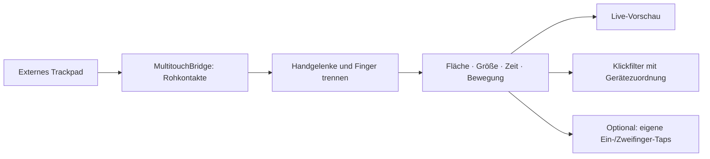

# PalmGuard

Native macOS-App für ein externes Apple Magic Trackpad unter einer Tastatur: eine frei
einstellbare Tap-Fläche, Live-Kontakte und ein Filter gegen versehentliche Klicks durch
aufliegende Handgelenke.

**Status: experimentelle erste Version.** Rohkontakte und Gerätezuordnung verwenden private
macOS-Schnittstellen. Die App zeigt ihre tatsächliche Wirkung über Diagnosezähler an;
eine perfekte Unterscheidung zwischen Absicht und Handballen ist nicht möglich.

## Starten

Voraussetzungen: macOS 14 oder neuer, Xcode mit Swift 6, externes Apple Magic Trackpad.
Keine Paketabhängigkeiten, kein Server, keine Telemetrie.

```sh
swift test
bash scripts/build-app.sh
open dist/PalmGuard.app
```

Für einen festen Installationsort die erstellte App nach `~/Applications` ziehen. macOS
verlangt die Freigabe für **Datenschutz & Sicherheit → Bedienungshilfen**. Wenn der
Ereigniszugriff weiter fehlt, zusätzlich **Eingabeüberwachung** prüfen und App neu starten.
Die App bietet direkte Schaltflächen zu diesen Einstellungen.

Lokale Builds werden ad hoc signiert. Für eine stabile eigene Signatur:

```sh
PALMGUARD_SIGNING_IDENTITY='Developer ID Application: …' bash scripts/build-app.sh
```

Ohne Developer-ID-Zertifikat ist der Build nicht notarisiert. Nach einem Neubau kann macOS
eine erneute Berechtigungsfreigabe verlangen. Die App läuft außerhalb der App Sandbox.

## Einrichten

1. App öffnen, Trackpad vollständig loslassen und die Live-Kontakte prüfen.
2. Im Trackpad-Bild die erlaubte Fläche als Rechteck ziehen. Alternativ die vier Randregler
   verwenden. Oben entspricht der Tastaturseite, unten der dir zugewandten Seite.
3. Handgelenke auflegen. Orange markiert Kontakte außerhalb der Fläche oder über der
   eingestellten Kontaktgröße. Grün markiert geometrisch zulässige Kontakte.
4. Modus auswählen und **Schutz aktivieren**. Beim Start bleibt die App zunächst in Vorschau.
5. Diagnose prüfen: Ein echter Trackpad-Klick sollte „Quellen zugeordnet“ erhöhen.
   Bleibt dieser Zähler bei null, greift der Klickfilter auf diesem System nicht.

### Vorhandene Klicks filtern

Standardmodus. Nur Links- und Rechtsklicks, deren Herkunft eindeutig dem ausgewählten
externen Trackpad zugeordnet werden kann, werden anhand frischer Kontaktinformationen
geprüft. Blockierte Mouse-down-Ereignisse erhalten auch kein Mouse-up/Drag-Gegenstück.
Unbekannte Quellen und fehlende oder veraltete Kontaktdaten passieren unverändert.

Das betrifft gegebenenfalls auch Druck-Klicks: macOS bietet keine dokumentierte zuverlässige
Unterscheidung zwischen Tap und Druck-Klick. Solange ein zulässiger Finger noch aufliegt,
bleiben Bewegung und langes Halten erlaubt, damit normales Drücken/Ziehen funktioniert.
Erst nach dem Abheben gilt der vollständige Tap-Zeit-/Bewegungsbefund. Ein früh ausgelöster
Tap-Klick kann deshalb passieren. Die App verzögert keine System-Klicks.

Ein gültiger Tap hält die Freigabe nach dem Abheben für 150 ms offen, auch wenn das Handgelenk
liegen bleibt. In diesem kurzen Fenster ist die Zuordnung eines weiteren Klicks mehrdeutig.

### Eigene Taps erzeugen

Für eine vollständig kontrollierte Tap-Erkennung: **natives „Tippen zum Klicken“ in den
macOS-Trackpad-Einstellungen ausschalten** und in PalmGuard bestätigen. Andere Tools dürfen
für dieses Trackpad ebenfalls keine zusätzlichen Tap-Klicks erzeugen.

PalmGuard erzeugt bei kurzen, stationären Kontakten in der erlaubten Fläche:

| Geste | Ergebnis |
| --- | --- |
| Ein Finger | Linksklick |
| Zwei nahezu gleichzeitig aufgesetzte Finger | Rechtsklick |
| Lange, wandernde oder mehr als zwei zulässige Kontakte | Kein erzeugter Klick |
| Große oder außerhalb gestartete Kontakte | Bis zum Abheben ignoriert |
| Handgelenk außerhalb plus neuer Finger innerhalb | Finger separat auswerten |

Die Kontaktgröße ist ein relativer Sensorwert, kein verlässlicher Druck- oder Flächenwert.
Schwellwerte lassen sich unter „Empfindlichkeit & Diagnose“ anpassen. Reale Druck-Klicks
und Scrollen brechen einen Tap-Kandidaten ab, damit kein zusätzlicher Klick erzeugt wird.
Tap-and-drag wird nicht nachgebildet; normales Drücken und Ziehen bleibt erhalten.

## Raycast / Hyperkey

PalmGuard registriert keine Tastatur-Hooks, keine globalen Shortcuts und keine
Tastenumbelegungen. Der Ereignisfilter enthält ausschließlich Maus-Klicks, Drag und Scrollen.
Erzeugte Klicks übernehmen den aktuellen Modifier-Zustand. Raycasts Hyperkey-Konfiguration
wird weder gelesen noch verändert. Ein echter Test deiner konkreten Shortcuts bleibt Teil
der Hardware-Abnahme.

## Grenzen und Wiederherstellung

- Es wird genau ein externes Trackpad ausgewählt; das eingebaute bleibt ausgeschlossen.
- Private Schnittstellen können durch macOS-Updates ausfallen. Unbekannte Geräteereignisse
  werden dann nicht blockiert. Diagnose und „Neu verbinden“ helfen bei der Prüfung.
- Bluetooth-Neuverbindung: „Neu verbinden“ drücken. Nach Ruhezustand wird neu verbunden;
  Schutz danach bewusst wieder aktivieren.
- Zeigerbewegung, Scrollen und Systemgesten werden nicht unterdrückt. Die App verhindert
  nicht jede Cursorbewegung eines aufliegenden Handballens.
- Die Erkennung verwendet Fläche, Kontaktgröße, Zeit und Bewegung. Ein Handballen mit
  fingerähnlichen Daten innerhalb der Fläche kann weiterhin als Finger erkannt werden.
- Pausieren beendet die Filterwirkung. Bei „Eigene Taps“ natives Tap-to-click bei Bedarf in
  macOS wieder einschalten; PalmGuard ändert diese Systemoption nicht selbst.
- Beenden entfernt den Event-Tap. Einstellungen liegen lokal in UserDefaults unter
  `de.sk2andy.PalmGuard`. Es werden keine Tastaturinhalte oder Kontaktverläufe gespeichert.

## Aufbau und Prüfung



| Verzeichnis | Zweck |
| --- | --- |
| `Sources/PalmGuardCore` | Reine, testbare Geometrie und Gestenerkennung |
| `Sources/MultitouchBridge` | Laufzeitgeladenes C-Interface zu macOS-Rohkontakten |
| `Sources/PalmGuard` | SwiftUI-Oberfläche, Persistenz und Mausereignisse |
| `Tests/PalmGuardCoreTests` | Randfälle, zeitliche Abläufe, Handgelenk/Finger-Kombinationen |
| `Tests/PalmGuardAppTests` | Übergabe von Hintergrund-Callbacks an die App |

```sh
swift test
xcrun swift-format lint --strict --recursive Sources/PalmGuard Sources/PalmGuardCore Tests Package.swift
bash scripts/build-app.sh
```

Zusätzliche Hardware-Abnahme: Ein-/Zweifinger-Taps, ruhende Handgelenke, Doppelklick,
Drücken/Ziehen, separate Maus, Scrollen, Bluetooth-Neuverbindung und eigene Raycast-Shortcuts.
Automatisierte Tests ersetzen diese Abnahme nicht.

## API-Quellen

- [Apple CGEvent](https://developer.apple.com/documentation/coregraphics/cgevent)
- [Apple CGEventField](https://developer.apple.com/documentation/coregraphics/cgeventfield)
- [Multitouch ABI-Referenz](https://github.com/calftrail/TrackMagic/blob/master/MultitouchSupport.h)
- [LinearMouse: private Gerätezuordnung](https://github.com/linearmouse/linearmouse/blob/main/LinearMouse/LinearMouse-Bridging-Header.h)
